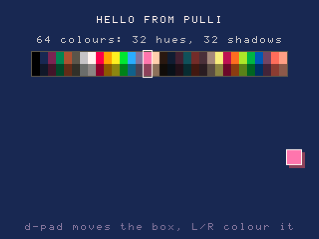

# Pulli

**English:** [README.md](README.md)

ஒவ்வொரு விளையாட்டும் Lua-வில் எழுதப்படும் ஒரு திறந்த மூல (open-source)
விளையாட்டுத் தளம்; அவற்றை ஓட்ட ஒரு கையடக்கக் கன்சோல்; யார் வேண்டுமானாலும்
உருவாக்கக்கூடிய மாதிரி வன்பொருள். Pulli (புள்ளி) என்றால் தமிழில் "dot":
ஒரு பிக்சல் ஒரு புள்ளி.

320×240, 64 நிறங்கள், 8×8 ஸ்பிரைட் கட்டங்கள், நொடிக்கு 60 ஃப்ரேம்கள்.
விளையாட்டுகள் ஒற்றை `.pulli` கோப்புகள். கணினியில் ஓடும் runtime-உம் கன்சோலும்
ஒரே engine-ஐ ஓட்டுகின்றன; அதனால் ஒரு விளையாட்டு மடிக்கணினியிலும் கையிலும்
ஒரே மாதிரி நடந்துகொள்ளும்.



## நிலை

மென்பொருள் முதலில்; வன்பொருள் கடைசியில்.

| பகுதி | நிலை |
|---|---|
| Spec v0.1 | வரைவு தயார்; அக்டோபர் 2026 திருத்தம் ஒப்புதலுக்குக் காத்திருக்கிறது (`docs/SPEC.md` §10) |
| Engine: rasterizer, package reader, save store, Lua API | உருவாக்கிச் சோதிக்கப்பட்டது; இன்னும் முழு API அல்ல ("இன்னும் செய்யப்படாதவை" பாருங்கள்) |
| கணினி host, சாளரத்துடனும் சாளரமின்றியும் | Linux-இல் (Raspberry Pi 5) உருவாக்கிச் சோதிக்கப்பட்டது |
| Reference rasterizer, conformance சோதனைகள் | தேர்ச்சி; C engine அதனுடன் பைட்டுக்குப் பைட் பொருந்துகிறது |
| பேக்கேஜ் வடிவமும் கட்டளை வரியும் | `new`, `pack`, `list`, `unpack`, `run`, `check`, `palette`, `add` |
| கணிதம் (`sin`, `cos`, `^` மற்றவை) | engine-இன் சொந்தம், ஒவ்வொரு கணினியிலும் அதே பிட்கள்; Pico 2 தன் சுயசோதனையில் தேறுகிறது |
| 16.16 fixed point (`fix`) | விளையாட்டுகளுக்கு விருப்பத்துக்குரியது; உருவாக்கிச் சோதிக்கப்பட்டது |
| இரண்டு கன்சோல்களுக்கு இடையே link | இரண்டு emulator சாளரங்களுக்கு இடையே வேலை செய்கிறது; இன்னும் வன்பொருள் link இல்லை |
| உரை | ஆங்கிலமும் தமிழும், உள்ளமைந்த பிக்சல் எழுத்துருக்களிலிருந்து; தமிழ் எழுத்துகள் Noto Sans Tamil-இலிருந்து முழுதாக வரையப்படுகின்றன |
| ஸ்பிரைட்டுகளும் வரைபடங்களும் | விளையாட்டு பேக் செய்யப்படும்போது PNG ஸ்பிரைட் தாள்களும் Tiled வரைபடங்களும் இறக்குமதியாகின்றன; ஒரு விளையாட்டு தன் சொந்த 64 நிறங்களைக் கொண்டுவரலாம் |
| SDK உதவி நிரல்கள் | 17, tween, dialog முதல் pathfind, மெனுக்கள் வரை; சாதாரண Lua, ஒரு விளையாட்டு require செய்யும்போது சேர்க்கப்படும் |
| விளையாட்டு உருவாக்குநர் வழிகாட்டி | தொடங்குதல், ஒரு பயிற்சி, ஓவியமும் ஒலியும், உதவி நிரல்கள், கையேடு: `docs/guide`; தமிழில் `docs/guide/ta` |
| எடுத்துக்காட்டுகள் | hello, pong, manickam, talk, catch; அனைத்தும் SDK உதவி நிரல்களைப் பயன்படுத்துகின்றன |
| ஒலி | 8 விளைவு அலைவரிசைகளும் இசையும், WAV கோப்புகளிலிருந்து உருவாக்கப்படுபவை; சாளரத்தில் ஒலிக்கிறது; board-இல் இன்னும் ஒலி வெளியீடு இல்லை |
| Firmware | ஒரே chip firmware ஒரு Pico 2 (RP2350)-இல் ஓடுகிறது: நொடிக்கு 60 ஃப்ரேம்களில் Pong, Manickam-உம் அதன் benchmark-உம்; இன்னும் திரையும் பொத்தான்களும் இல்லை; அதன் இரண்டாம் core வரைய உதவுகிறது. GPU chip-இன் firmware இன்னும் தொடங்கப்படவில்லை |
| திருத்தி (Pattarai), கடை (Santhai), தொடக்கி (Vaasal) | தொடங்கப்படவில்லை |

## இன்னும் செய்யப்படாதவை

`docs/SPEC.md`-உடன் ஒப்பிட்டால்:

- `stat("fps")`, `stat("cpu")` ஆகியவற்றுக்கு, port-இல் ஒரு கடிகாரம் இருக்கும்
  இடத்தில் மட்டுமே விடை உண்டு: சாளரத்திலும் firmware-இலும் உண்டு; சாளரமின்றி
  ஓடும் runner-இல் இல்லை, சோதனைகளுக்காக `--clock-step` ஒரு போலிக் கடிகாரம்
  தந்தால் தவிர.
- பேக்கேஜ்களில் Lua மூல நிரல் மட்டுமே: bytecode, மறைகுறியாக்கப்பட்ட, கையொப்பமிட்ட
  பேக்கேஜ்கள் மறுக்கப்படுகின்றன.
- `check` நிலையான பகுப்பாய்வு (static analysis) செய்வதில்லை; `run`-க்கு hot reload
  இல்லை.
- Spec-இன் GPU coprocessor (§1) ஒரு திட்டமாக மட்டுமே உள்ளது: இன்று ஒரே chip
  அனைத்தையும் செய்கிறது; அதன் இரண்டாம் core வரைய உதவுகிறது.
- பேக்கேஜ்கள் முழுதாக நினைவகத்தில் படிக்கப்படுகின்றன. 64 MB வரையிலான பேக்கேஜைப்
  பகுதி பகுதியாகப் படித்தல், `preload`, `sheet.load`, `stat("active")` (SPEC §2,
  §3) இன்னும் உருவாக்கப்படவில்லை; cartridge slot-உம் இல்லை.
- Firmware-இல் இன்னும் திரை, பொத்தான்கள், ஒலி வெளியீடு, SD card, சேமிப்பகம்
  இல்லை.
- Tiled-இல் உருவாக்கிய வரைபடங்களிலிருந்து டைல் அடுக்குகள் மட்டுமே வருகின்றன,
  objects அல்ல.
- 64-பிட் கணினியில் Lua மதிப்புகள் பெரியவை என்பதால், கணினியின் Lua heap வரம்பு
  கருவியில் இருப்பதைவிடக் கடுமையானது.

## அமைப்பு

```
docs/        SPEC.md, the platform contract; guide/, the game developer's guide
runtime/     the engine, shared unchanged by every port
host/        desktop frontends: pulli-host (SDL2 window), pulli-headless
firmware/    RP2350 port (bring-up stage)
sdk/         helpers written in Lua for games to require: tween, dialog and more
tools/       pulli.py command line, reference rasterizer and mixer, font generator
tests/       font, conformance, package, runtime, maths, audio, asset, SDK, guide, link and example tests
examples/    hello, pong, manickam, talk, catch (the tutorial's game)
cmake/       pinned Lua build shared by host and firmware
```

- `docs/`: தள ஒப்பந்தமான SPEC.md; விளையாட்டு உருவாக்குநர் வழிகாட்டி `guide/`
  (தமிழில் `guide/ta/`).
- `runtime/`: ஒவ்வொரு port-உம் மாற்றாமல் பகிரும் engine.
- `host/`: கணினி முகப்புகள்: pulli-host (SDL2 சாளரம்), pulli-headless.
- `firmware/`: RP2350 port (தொடக்க நிலை).
- `sdk/`: விளையாட்டுகள் require செய்ய Lua-வில் எழுதிய உதவி நிரல்கள்.
- `tools/`: pulli.py கட்டளை வரி, reference rasterizer, mixer, எழுத்துரு உருவாக்கி.
- `tests/`: அனைத்துச் சோதனைகளும்.
- `examples/`: எடுத்துக்காட்டு விளையாட்டுகள் (catch பயிற்சியின் விளையாட்டு).
- `cmake/`: host-உம் firmware-உம் பகிரும், பதிப்பு நிலைநிறுத்தப்பட்ட Lua உருவாக்கம்.

`runtime/`-இல் எந்தத் தளம் சார்ந்த நிரலும் இல்லை. Port செய்வது என்றால்
`host/`, `firmware/` போல ஒரு backend-உம் main loop-உம் எழுதுவது; engine-உம் அது
வரையும் ஒவ்வொரு பிக்சலும் அப்படியே இருக்கும்; அது உண்மையாக இருக்கவே `tests/`
உள்ளது.

## உருவாக்குதலும் சோதித்தலும்

ஒரு C கம்பைலர், CMake 3.16+, Python 3, சாளரத்துக்கு SDL2 தேவை. முதல் configure-இல்
CMake Lua-வைப் பதிவிறக்கி உருவாக்குகிறது; கணினியில் உள்ள Lua பயன்படுத்தப்படுவதில்லை.

```bash
# Debian, Ubuntu, Raspberry Pi OS
sudo apt install build-essential cmake ninja-build python3 libsdl2-dev
# macOS
brew install cmake ninja sdl2

cmake -S . -B build -G Ninja
ninja -C build
(cd build && ctest --output-on-failure)
```

SDL2 இல்லாமல், சாளரமுள்ள `pulli-host` தவிர அனைத்தும் உருவாகும், சோதனைகளும்
ஓடும்.

## ஒரு விளையாட்டை உருவாக்கி ஓட்டுதல்

**[நூல், விளையாட்டு உருவாக்குநர் வழிகாட்டி](docs/guide/ta/README.md)** ஒன்றுமில்லாத
நிலையிலிருந்து தொடங்கி எட்டுப் படிகளில் ஒரு முழு விளையாட்டை உருவாக்குகிறது; பிறகு
ஓவியம், ஒலி, வரைபடங்கள், உதவி நிரல்கள், ஒவ்வொரு ஃபங்ஷனையும் விளக்குகிறது.
கீழே உள்ளது சுருக்கம்.

```bash
python3 tools/pulli.py new mygame          # scaffold manifest.lua and main.lua
python3 tools/pulli.py run mygame          # play it in a window
python3 tools/pulli.py check mygame        # run 600 frames with no window
python3 tools/pulli.py pack mygame         # write mygame.pulli

python3 tools/pulli.py run examples/pong 2 # 2 = window scale; 3 when left out
```

`new` manifest.lua, main.lua-வை உருவாக்குகிறது; `run` சாளரத்தில் விளையாட வைக்கிறது;
`check` சாளரமின்றி 600 ஃப்ரேம்கள் ஓட்டுகிறது; `pack` mygame.pulli எழுதுகிறது.
கடைசி வரியில் 2 என்பது சாளரப் பெரிதாக்கல். அது இல்லாவிட்டால் `run` சாளரத்தைக்
கன்சோலின் 320×240-ஐ விட மூன்று மடங்காக, 960×720-இல் திறக்கும்; விளையாட்டுக்குப்
பின் 1 முதல் ஒரு எண் கொடுத்தால் வேறு அளவு.

படங்களுக்கு, எந்த ஓவிய நிரலிலும் 8x8 ஸ்பிரைட் கட்டம் வரைந்து, விளையாட்டின்
கோப்புறையில் `sprites.png` என்று சேமியுங்கள்: `spr(n)` n-ஆவதை வரையும்.
`python3 tools/pulli.py palette pulli.gpl` ஓவிய நிரல் ஏற்றுவதற்காக 64 நிறங்களை
எழுதுகிறது. வரைபடத்துக்கு, [Tiled](https://www.mapeditor.org)-இல் 8x8 டைல்களுடனும்
`sprites.png`-ஐ tileset ஆகவும் கொண்டு ஒன்றை உருவாக்கி, அதன் அருகில் `map.tmx`
என்று சேமியுங்கள். `examples/manickam` இரண்டையும் செய்கிறது; அதுவே மிக முழுமையான எடுத்துக்காட்டு:
தமிழிலும் ஆங்கிலத்திலும் ஒரு முழு சாகசம்: தொடக்கக் காட்சி, Tiled-இல் வரைந்த ஆறு
பகுதிகள் (மிகப் பெரியது 128x128 டைல்கள்), விளக்குகள் ஒளிரும் இரவு, கண்ணாடிப் புதிர்கள்,
ஒரு மோதல், ஒரு திருவிழா, சேமிக்கப்படும் முன்னேற்றம், பத்து இசைத் துண்டுகள், முப்பது ஒலி விளைவுகள்.
அதன் தலைப்புத் திரையில் SELECT அழுத்தினால், ஒரு கருவி எப்படிச் சமாளிக்கிறது என்று
சொல்லும் benchmark இயங்கத் தயாராகும். அதை எப்படி விளையாடுவது, அதன் கதை, அதன்
ஒவ்வொரு கோப்பும் அதன் சொந்த [README](examples/manickam/README.ta.md)-இல் உள்ளன.

ஒலிக்கு, விளையாட்டினுள் ஒரு `sfx/` கோப்புறையிலும் `music/` கோப்புறையிலும்
`.wav` கோப்புகளை வையுங்கள். `pack`, `run` அவற்றைப் பெயர் வரிசைப்படி 0 முதல்
எண்ணுகின்றன; அதனால் `sfx/0-jump.wav` `sfx(0)`-உடனும் `music/0-theme.wav`
`music(0)`-உடனும் ஒலிக்கும். `examples/pong/sfx` பாருங்கள்.

விளையாட்டுக்கான `README.md` போன்ற Markdown குறிப்புகள் அதன் கோப்புறையிலேயே
இருக்கும்; பேக்கேஜில் சேர்க்கப்படுவதில்லை.

link விளையாட்டை முயல, ஒரே போர்ட்டுடன் இரண்டு சாளரங்களைத் தொடங்கி இரண்டிலும்
LINK PLAY தேர்ந்தெடுங்கள்:

```bash
python3 tools/pulli.py run examples/pong 2 --link 7000 &
python3 tools/pulli.py run examples/pong 2 --link 7000
```

விசைகள்: அம்புக்குறிகள் நகர்த்தும், `Z`/`X` என்பவை A/B, `A`/`S` என்பவை X/Y,
`Q`/`W` என்பவை L/R, Enter என்பது start, வலது Shift என்பது select, Esc வெளியேறும்.

ஒரு விளையாட்டைப் பல Lua கோப்புகளாகப் பிரிக்கலாம்: `require("enemies")`
விளையாட்டின் கோப்புறையிலிருந்து `enemies.lua`-வை ஓட்டுகிறது. `sdk/`-இல் உள்ள
SDK உதவி நிரல்கள் அந்த வகைக் கோப்புகளே; ஒரு விளையாட்டு அவற்றை require செய்தால்
போதும் (நகலெடுக்க எதுவும் இல்லை: பேக் செய்யும்போது அது சேர்க்கப்படும்):

```lua
local tween = require("tween")     -- nothing to copy: packing the game puts it in
```

```bash
python3 tools/pulli.py add                   # lists the helpers
python3 tools/pulli.py add mygame dialog     # copies dialog.lua in, to change it
```

முதல் கட்டளை உதவி நிரல்களைப் பட்டியலிடுகிறது; இரண்டாவது dialog.lua-வை மாற்றுவதற்காக
உள்ளே நகலெடுக்கிறது. விளையாட்டின் கோப்புறையில் உள்ள கோப்பு SDK-யினுடையதற்குப்
பதிலாகப் பயன்படுத்தப்படுகிறது; ஒரு விளையாட்டு ஒரு உதவி நிரலை மாற்றுவது
இப்படித்தான். ஒவ்வொரு உதவி நிரலும் அதன் கோப்பின் மேலே தன்னை விளக்குகிறது;
`docs/SPEC.md` §3 அனைத்தையும் பட்டியலிடுகிறது; ஒவ்வொரு எடுத்துக்காட்டும்
அவற்றில் சிலவற்றைப் பயன்படுத்துகிறது.

ஒரு விளையாட்டு என்பது `manifest.lua`-உம் `main.lua`-உம் உள்ள ஒரு கோப்புறை:

```lua
function init()      end   -- once
function update(dt)  end   -- 60 times a second; dt is always 1/60
function draw()      end   -- after each update

-- cls pset pget line rect rectfill circ circfill shade spr sspr print text_size
-- camera clip pal palt palette fade   btn btnp
-- sfx music music_stop music_pause   save load save_commit   time stat dbg
-- map.load map.size map.draw map.get map.set map.flags   require
-- link.status link.side link.send link.recv   sys.has
-- fix.from fix.to fix.floor fix.mul fix.div fix.sqrt fix.sin fix.cos fix.atan
```

`init` ஒரு முறை ஓடும்; `update` நொடிக்கு 60 முறை, `dt` எப்போதும் 1/60; `draw`
ஒவ்வொரு update-க்குப் பிறகும். `docs/SPEC.md` §3 முழு API.

## Firmware

`arm-none-eabi-gcc` தேவை. [Pico SDK](https://github.com/raspberrypi/pico-sdk)
பதிப்பு 2.3.1-இல் நிலைநிறுத்தப்பட்டு முதல் உருவாக்கத்தில் பதிவிறக்கப்படுகிறது
(சுமார் 120 MB, `firmware/build`-க்குள்). உங்கள் சொந்த நகலைப் பயன்படுத்த
`PICO_SDK_PATH` அமையுங்கள்; அது 2.3.0 அல்லது புதியதாக இருக்க வேண்டும்.

```bash
cmake -S firmware -B firmware/build -G Ninja      # board: pico2
ninja -C firmware/build                           # firmware/build/pulli.uf2
```

அதை ஒரு Pico 2-இல் ஏற்ற, BOOTSEL-ஐ அழுத்திப் பிடித்தபடி board-ஐ இணைத்து, தோன்றும்
drive-க்கு `pulli.uf2`-ஐ நகலெடுங்கள்; அல்லது
[picotool](https://github.com/raspberrypi/picotool) நிறுவியிருந்தால்
`picotool load -x -f firmware/build/pulli.uf2` ஓட்டுங்கள்.

அது திரையின்றி Pong-ஐ ஓட்டி, update, draw, திரை மாற்ற நேரங்களையும் Lua
நினைவகத்தையும் நொடிக்கு ஒரு முறை USB serial-இல் அச்சிடுகிறது. 150 MHz-இல் ஓடும்
Pico 2-இல் Pong-இன் update-உம் draw-உம் ஒரு ஃப்ரேமுக்குச் சுமார் 2 ms எடுக்கின்றன;
ஒரு ஃப்ரேமைத் திரையின் நிறங்களுக்கு மாற்றச் சுமார் 5 ms. மிகப் பெரிய வரைதல்
அழைப்புகளான `map.draw`, `shade`, `sspr` திரையின் இரு பாதிகளாக வரையப்படுகின்றன,
chip-இன் இரண்டு core-களிலும் ஒவ்வொன்றாக. தொடக்கத்தில் கணிதச்
சோதனை தேறியதா என்று அச்சிடுகிறது: கணினி கணக்கிடுவதையே board சரியாகக் கணக்கிட
வேண்டும். `-DPULLI_GAME=<folder>` வேறொரு விளையாட்டை இணைக்கும். board-இல் இன்னும்
பொத்தான்கள் இல்லை: Pong-க்கு, தலைப்புத் திரையைத் தாண்ட firmware ஒவ்வொரு இரண்டு
நொடிக்கும் A-ஐத் தட்டுகிறது; `-DPULLI_AUTO_A_SECONDS=<n>` மற்ற விளையாட்டுக்கும்
அதையே செய்யும் (0 அதை நிறுத்தும்).

## வரைதல் அல்லது ஒலியை மாற்றுதல்

`tools/refgfx.py` ஒவ்வொரு வரைதல் அழைப்புக்கும் மாதிரி (reference); `runtime/gfx.c`
அதனுடன் பொருந்த வேண்டும். வேண்டுமென்றே செய்த மாற்றத்துக்குப் பிறகு இரண்டையும்
புதுப்பித்து, `python3 tests/test_conformance.py --update` ஓட்டி, commit செய்யும்
முன் புதிய `tests/golden.png`-ஐப் பாருங்கள். எழுத்துரு `runtime/font.txt`-இல்
உள்ளது; `python3 tools/mkfont.py` `runtime/font.c`-ஐ மீண்டும் உருவாக்குகிறது.

ஒலியும் அப்படியே: `tools/refaudio.py` மாதிரி mixer; `runtime/audio.c` அதே
மாதிரிகளை (samples) உருவாக்க வேண்டும். `tests/test_audio.py` அவற்றை ஒப்பிடுகிறது;
`pulli-headless --dump-wav out.wav` ஒரு விளையாட்டு இசைத்ததைச் சேமிக்கிறது.

## மாற்றங்களும் சோதனைகளும்

`main`-க்கு எதுவும் நேரடியாகத் தள்ளப்படுவதில்லை. வேலை ஒரு feature branch-இல்
நடந்து, ஒரு pull request மூலம் `main`-ஐ அடைகிறது; CI சோதனைகள் தேறியதும் squash-merge
செய்யப்படுகிறது.

- `.github/workflows/ci.yml` ஒவ்வொரு pull request-இலும் `main`-க்கான ஒவ்வொரு
  push-இலும் ஓடுகிறது: `desktop` வேலை அனைத்தையும் உருவாக்கி எல்லாச் சோதனைகளையும்
  ஓட்டுகிறது; `firmware` வேலை Pico 2 image-ஐ உருவாக்குகிறது. இரண்டும் தேற வேண்டும்.
- `v0.1.0` போன்ற ஒரு tag தள்ளப்படும்போது `.github/workflows/release.yml` ஓடுகிறது:
  அது சோதித்து, firmware-ஐயும் எடுத்துக்காட்டு விளையாட்டுகளையும் உருவாக்கி ஒரு
  GitHub release-இல் இணைக்கிறது.
- `.github/rulesets/` `main`-க்கும் release tags-க்குமான விதிகளைக் கொண்டுள்ளது.
  ஒவ்வொன்றையும் Settings, Rules, Rulesets, New ruleset, Import a ruleset வழியாக
  இறக்குமதி செய்யுங்கள். கூட்டுப் பணியாளர்கள் branches தள்ளலாம், pull requests
  திறக்கலாம்; ஒரு pull request-க்கு code-owner ஒப்புதல் தேவை
  (`.github/CODEOWNERS`), அதை உரிமையாளர் மட்டுமே தர முடியும்; release tags-ஐயும்
  உரிமையாளர் மட்டுமே உருவாக்க முடியும். GitHub rulesets-ஐ பொது repositories-இலோ
  கட்டணத் திட்டங்களிலோ மட்டுமே கட்டாயப்படுத்துகிறது; அதுவரை இந்த விதிகள்
  ஒப்பந்தத்தால் பின்பற்றப்படுகின்றன, கட்டாயப்படுத்தப்படுவதில்லை.

## உரிமம்

மென்பொருள் Apache License 2.0-இன் கீழ் உரிமம் பெற்றது (`LICENSE`, நன்றிகள்
`NOTICE`-இல்). பங்களிப்புகள் அதே விதிகளின் கீழ் ஏற்கப்படுகின்றன.

ஒரு பகுதி மட்டும் வேறு: தமிழ் எழுத்துரு (`runtime/font_ta.txt`, அதிலிருந்து
உருவாக்கப்படும் `runtime/font_ta.c`) Noto Sans Tamil-இலிருந்து உருவாக்கப்பட்டது,
SIL Open Font License 1.1-இன் கீழ் உள்ளது (`third_party/noto-sans-tamil/OFL.txt`).
அதை Pulli-யிலும் அதன் firmware-இலும் பயன்படுத்தலாம், மாற்றலாம், சேர்த்து
வழங்கலாம்; தனியாக விற்க முடியாது. தமிழ் அச்சிடும் விளையாட்டுகளை இது பாதிக்காது.

வன்பொருள் வடிவமைப்புகள் சேர்க்கப்படும்போது CERN-OHL-S v2-இன் கீழ் வெளியிடப்படும்;
இந்த repository-இல் இன்னும் எதுவும் இல்லை. Pulli, Vaasal மற்றும் பிற பெயர்கள்
உரிமத்தின் கீழ் வருவதில்லை.

ஆங்கிலப் பதிப்பே அதிகாரப்பூர்வமானது; இரண்டும் வேறுபட்டால் ஆங்கிலத்தைப் பின்பற்றுங்கள்.
