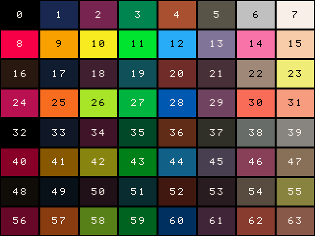

# Art and sound

**தமிழ்:** [ta/art-and-sound.md](ta/art-and-sound.md)

Pictures, maps and sounds are made with ordinary tools and dropped into the
game's folder. When the game is packed, Pulli converts them into the forms
the console reads; you never handle those yourself.

## The palette

Every pixel on Pulli is one of 64 colours, numbered 0 to 63:



- Colours 32 to 63 are darker shades of 0 to 31, exactly 32 apart. So
  `pal(c, c + 32)` swaps a colour for its shadow, which is an easy way to
  dim a sprite.
- **Colour 0 is see-through in sprites.** Use colour 32, also black, for
  solid black.
- Write the palette out for your paint program, and draw with exactly
  these colours:

  ```bash
  python3 tools/pulli.py palette pulli.gpl   # GIMP, Aseprite, Krita
  python3 tools/pulli.py palette pulli.hex   # one colour per line
  python3 tools/pulli.py palette pulli.png   # an 8 x 8 swatch
  ```

### A palette of your own

To use other colours, put a file called `palette.hex` (one `rrggbb` colour
a line) or `palette.gpl` (the format GIMP, Aseprite and Krita save) in the
game's folder, with exactly 64 colours. The game then shows those colours
instead, and `pack` matches your `sprites.png` to them, so draw with the
palette loaded in your paint program. Colour 0 is still the see-through
one, and the rest of the guide's colour numbers refer to your palette.

Write a game's palette back out for a paint program, from its folder or
its packed file:

```bash
python3 tools/pulli.py palette mygame mygame.gpl
python3 tools/pulli.py palette mygame.pulli mygame.png
```

To change a colour while the game runs, `palette(c, r, g, b)` sets colour
`c` to red, green and blue values from 0 to 255, `palette(c)` reads it, and
`palette()` puts the game's colours back. Cycling a colour this way is a
cheap trick for water and fire.

## Sprites

Draw your sprites on a grid of 8 × 8 squares and save it as `sprites.png`
in the game's folder.

- The picture's width and height must be multiples of 8, and it may hold
  at most 131,072 pixels (for example 512 × 256).
- Sprites are numbered left to right, then top to bottom, from 0.
  `spr(n, x, y)` draws number `n`.
- A bigger sprite is several cells: `spr(n, x, y, 2, 2)` draws a 16 × 16
  sprite whose top-left cell is `n`.
- See-through pixels (less than half opaque) become colour 0. Every other
  pixel becomes the nearest of colours 1 to 63. If a colour had to change,
  `pack` says so: load the palette into your paint program to avoid it.
- Any PNG works except an interlaced one.

## Maps

Maps are made in [Tiled](https://www.mapeditor.org), a free map editor.

1. In Tiled, make a new map: orthogonal, tile size 8 × 8, not infinite.
2. Add a tileset from `sprites.png`, tile size 8 × 8, with no margin or
   spacing. Tile `n` in Tiled is sprite `n` in the game.
3. Draw on up to two tile layers. The first becomes layer 0, drawn first;
   the second becomes layer 1, drawn on top.
4. Save the map as `map.tmx` in the game's folder.

A game with a `map.ooru` starts with it loaded, so after packing,
`map.draw(0)` and `map.draw(1)` draw it. Other maps, such as `level2.tmx`,
are loaded with `map.load("level2.ooru")`.

**Walls and other tile properties.** In Tiled's tileset view, select a tile
and add a custom property:

- `solid`, a bool: ticked, the tile is a wall. `map.flags(tile) & 1` is then
  1, and the `move` and `pathfind` helpers treat it as a wall.
- `flags`, an int from 0 to 255, for your own uses: eight on-off bits per
  tile, such as "water" or "hurts". In `examples/manickam` water has
  `flags` 2 and is not solid: anyone can wade in, and the game checks
  `map.flags(tile) & 2` to slow the player down.

**Things to know:**

- Tile 0 is empty, so maps never draw the sheet's first cell. Keep it blank.
- Tiles may be flipped in Tiled; rotated tiles are refused.
- A map holds at most 32,768 tiles over both layers, for example two
  layers of 128 × 128.
- Object layers come with the map. Place a player's start, enemies or
  doors as objects (points, boxes or tiles) on an object layer, give them
  a class and custom properties, and read them with `map.objects()` when
  the map is loaded. Rotation and text objects are not imported; detach
  objects made from a template.

## Text in Tamil

Games can write Tamil as well as English, in titles, dialogue and anything
else `print` draws. Type it straight into your Lua file:

```lua
print("வணக்கம்! Hello!", 8, 20, 7)     -- Tamil and English on one line
local w = text_size("மாணிக்கம்")       -- how wide it is, to centre it
print("மாணிக்கம்", 160 - w // 2, 50, 10)
```

- Save your Lua files as UTF-8. Every current editor does unless told not to.
- A line holding Tamil is 22 pixels tall, so leave that much room for it.
  `print` does this itself after a `\n`, and `text_size` tells you the size
  of any text.
- Pulli draws each syllable whole: type கொ as you normally would and it
  comes out right, with its vowel signs where they belong.
- The `text`, `dialog` and `menu` helpers measure and wrap Tamil properly,
  and space their lines for it.
- The Tamil letters come from the font Noto Sans Tamil, turned into pixels,
  and are under the SIL Open Font License: games that use them are not
  affected. See `docs/SPEC.md` §3, "Text".

## Sound effects and music

Put `.wav` files in a `sfx` folder and a `music` folder inside the game.

```
mygame/
  sfx/0-jump.wav       sfx(0)
  sfx/1-coin.wav       sfx(1)
  music/0-theme.wav    music(0)
```

- Files are numbered from 0 in order of their names, so start names with a
  number to keep the order clear.
- Mono or stereo, 8 to 32 bit, 4,000 to 48,000 samples a second. Plain PCM
  WAV only; export from your audio editor as "WAV, signed 16-bit PCM" if
  unsure.
- Sound effects are kept exactly as they are. Music is stored at a quarter
  of the size, at a small cost in quality.
- Music loops. If the WAV file marks a loop point, it loops from there;
  otherwise from the start. `music(0, 500)` fades it in over half a second,
  and `music_stop(500)` fades it out.
- Up to eight sound effects play at once, with music on top. They add up,
  so leave some headroom: eight loud sounds together distort.

Keep music short and looping. A 12-second loop at 11,025 samples a second
is about 66 KB once packed.
